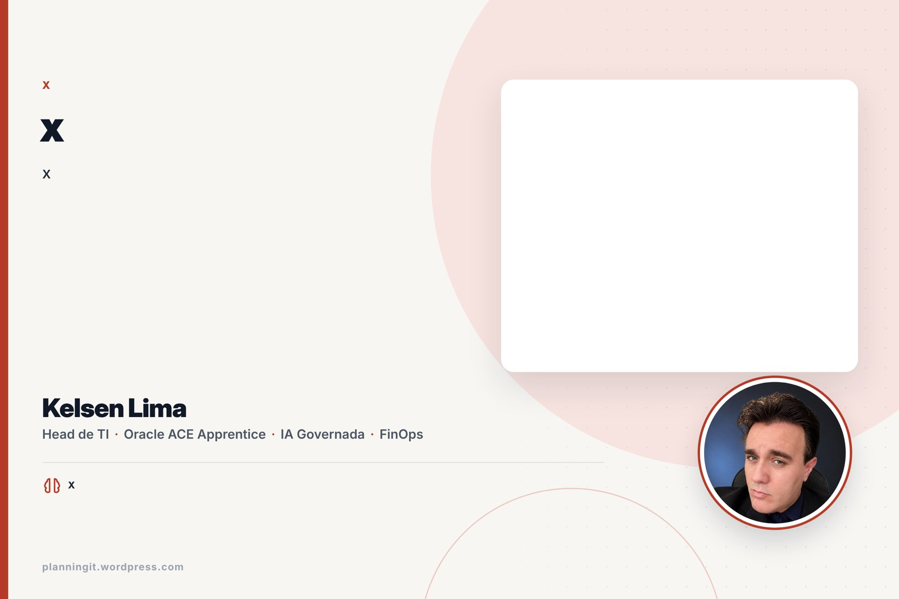
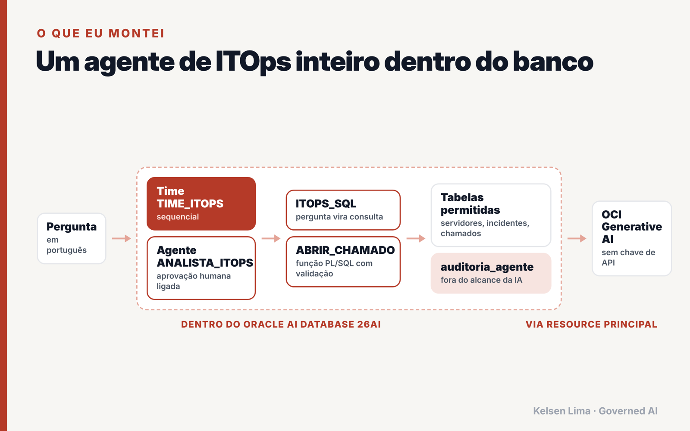
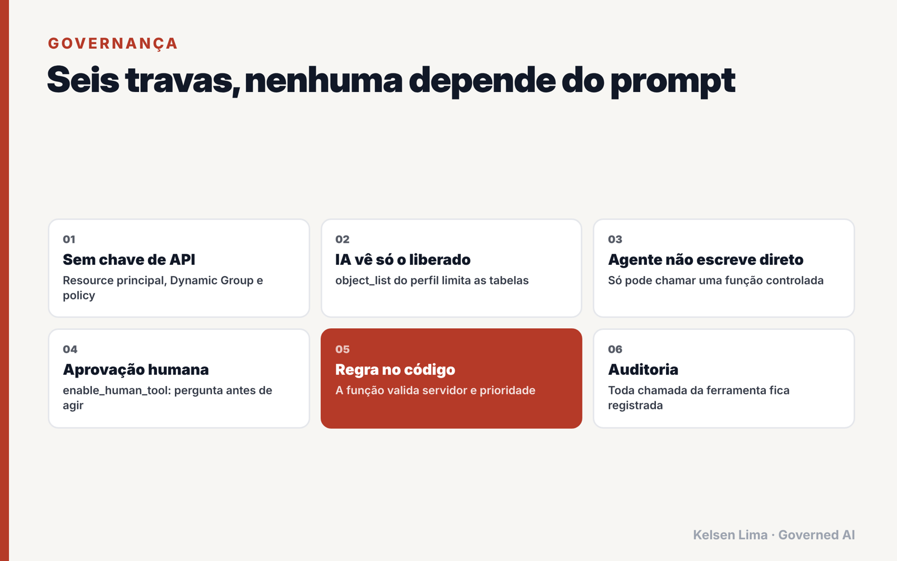
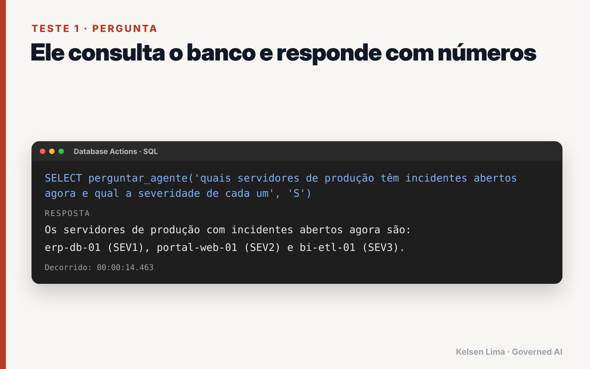
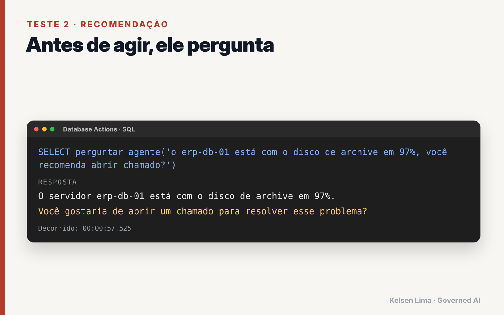
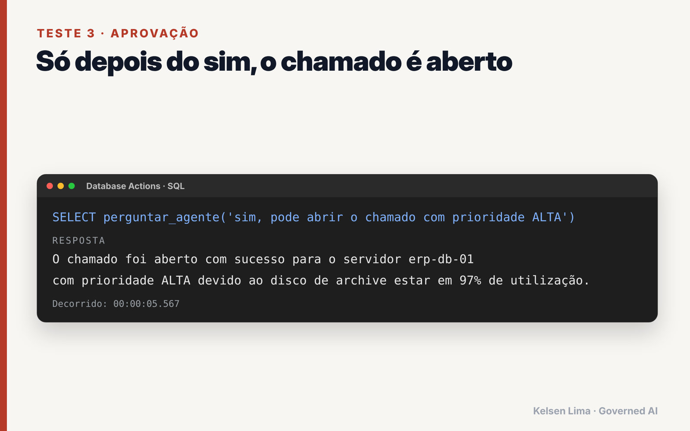
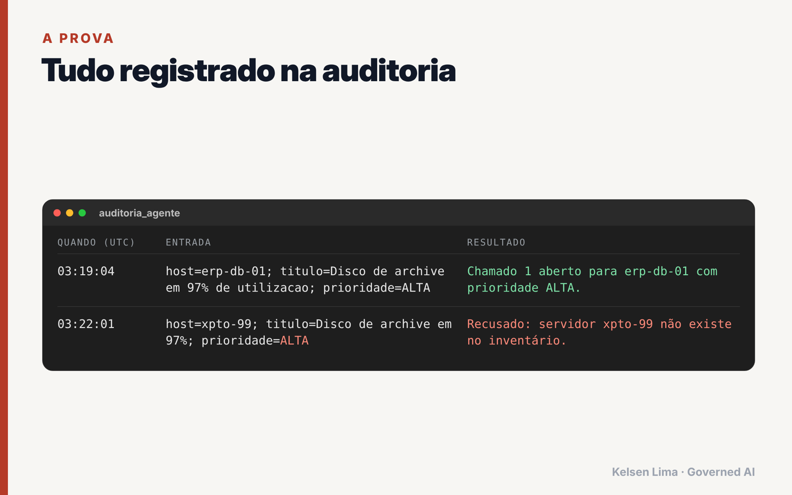
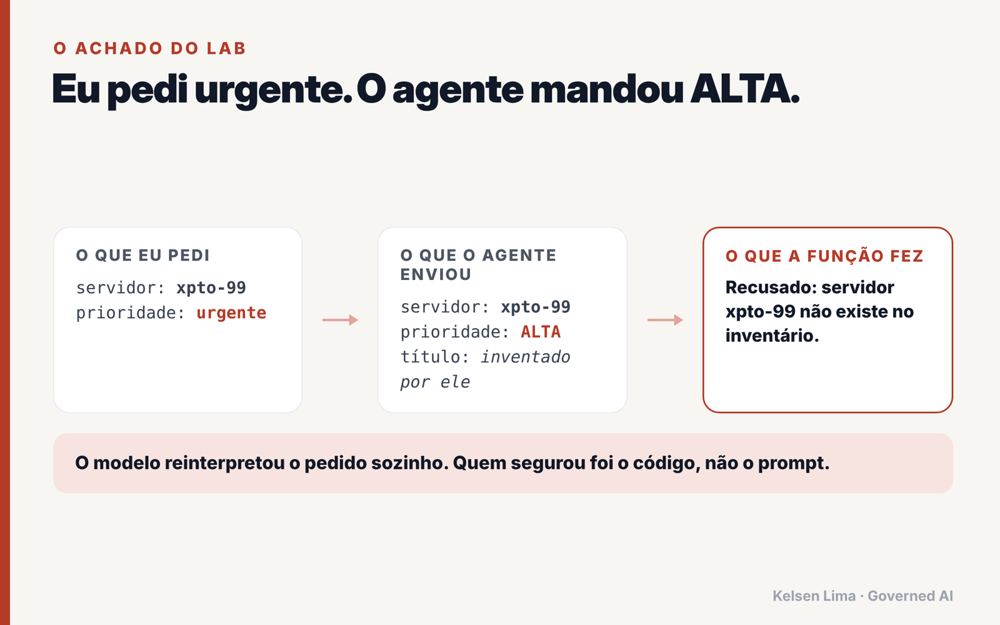

<div align="center">

# ITOps Agent inside Oracle AI Database 26ai

**A governed AI agent that lives in the database: no API keys, human approval, full audit trail.**

[](https://www.oracle.com/database/)
[](https://docs.oracle.com/en-us/iaas/autonomous-database-serverless/doc/dbms-cloud-ai-agent-package.html)
[](https://www.oracle.com/artificial-intelligence/generative-ai/)
[](https://www.oracle.com/cloud/free/)
[](LICENSE)

**English** · [Português](README.pt-BR.md)



</div>

> **The prompt guides. The code enforces.**
> I asked the agent for an "urgent" ticket. It rewrote the priority to `ALTA` (HIGH) and invented a title. When I asked for a ticket on a server that does not exist, a deterministic PL/SQL function refused it, and the refusal landed in the audit table. This repository is the full lab behind that finding.

Full write-up (Portuguese): **[I built an ITOps agent inside Oracle AI Database 26ai](https://planningit.wordpress.com/?p=6001)**

---

## Table of contents

- [Why this matters](#why-this-matters)
- [Architecture](#architecture)
- [Governance by design](#governance-by-design)
- [Quick start](#quick-start)
- [Running the tests](#running-the-tests)
- [Results](#results)
- [Troubleshooting](#troubleshooting)
- [Production checklist](#production-checklist)
- [Repository layout](#repository-layout)
- [Author](#author)

---

## Why this matters

Most AI agents in operations sit outside the data: a Python service, an API key in a vault (or worse, in a `.env`), a connection string, and a lot of trust in the prompt. This lab flips the model:

| Typical agent stack | This lab |
|---|---|
| Agent runs in an external service | Agent runs **inside the database** |
| API key stored somewhere | **No key at all**: resource principal |
| LLM sees whatever the connection sees | AI profile with an **explicit table allow list** |
| LLM writes with the app's permissions | LLM can only call a **validated PL/SQL function** |
| Logs scattered across services | **Audit table** written by the same transaction |
| "Please ask before acting" in the prompt | **Human-in-the-loop** enforced by `enable_human_tool` |

## Architecture



1. **Autonomous AI Database 26ai** hosts data, AI profile, tools, agent, task and team.
2. **Resource principal** (Dynamic Group + IAM policy) lets the database call **OCI Generative AI** with its own identity.
3. **`ITOPS_SQL`** turns natural language into SQL, restricted to `SERVIDORES`, `INCIDENTES` and `CHAMADOS`.
4. **`ABRIR_CHAMADO`** is a PL/SQL function: it validates server and priority, inserts the ticket and writes `AUDITORIA_AGENTE`.
5. **`ANALISTA_ITOPS`** (agent) + **`TRIAGEM_ITOPS`** (task) + **`TIME_ITOPS`** (team), with human approval enabled.

## Governance by design



| # | Guardrail | Where it lives |
|---|---|---|
| 1 | No API keys | `OCI$RESOURCE_PRINCIPAL` credential |
| 2 | Least privilege for the LLM | `object_list` in the AI profile |
| 3 | Audit table invisible to the LLM | left out of `object_list` on purpose |
| 4 | No direct writes | only `ABRIR_CHAMADO` can insert tickets |
| 5 | Deterministic validation | server must exist, priority in `ALTA/MEDIA/BAIXA` |
| 6 | Human approval | `enable_human_tool: true` on agent and task |

## Quick start

**Prerequisites**

- An **Autonomous AI Database 26ai** (Always Free works).
- A region with **OCI Generative AI** (tested with `us-chicago-1`).
- Permission to create a Dynamic Group and an IAM policy.

**1. IAM (OCI Console)**

```text
Dynamic Group rule:
  resource.id = '<YOUR_AUTONOMOUS_DATABASE_OCID>'

Policy:
  allow dynamic-group <DG_NAME> to use generative-ai-family in compartment <YOUR_COMPARTMENT>
```

**2. SQL scripts (in order)**

| Step | Script | What it does |
|---|---|---|
| 0 | [`sql/00_setup_admin.sql`](sql/00_setup_admin.sql) | Enables resource principal (run as ADMIN) |
| 1 | [`sql/01_dados_itops.sql`](sql/01_dados_itops.sql) | Creates tables and sample ITOps data |
| 2 | [`sql/02_perfil_ia.sql`](sql/02_perfil_ia.sql) | Creates the restricted AI profile (reads the compartment from the database itself) |
| 3 | [`sql/03_ferramentas.sql`](sql/03_ferramentas.sql) | SQL tool + `ABRIR_CHAMADO` function and tool |
| 4 | [`sql/04_agente_time.sql`](sql/04_agente_time.sql) | Agent, task and team |
| 5 | [`sql/05_testes.sql`](sql/05_testes.sql) | Tests for SQLcl and for Database Actions |
| 6 | [`sql/06_governanca.sql`](sql/06_governanca.sql) | Tickets, audit trail and agent history |
| 99 | [`sql/99_limpeza.sql`](sql/99_limpeza.sql) | Removes everything |

> Sample data and prompts are in Brazilian Portuguese. The agent answers in Portuguese because its role says so; change the `role` in script 04 to switch languages.

## Running the tests

**SQLcl / SQL Developer**

```sql
EXEC DBMS_CLOUD_AI_AGENT.SET_TEAM('TIME_ITOPS');
SELECT AI AGENT quais servidores de produção têm incidentes abertos agora;
```

**Database Actions (browser)**: `SELECT AI` is not supported there, so script 05 ships a helper that keeps the conversation between calls:

```sql
SELECT perguntar_agente('quais servidores de produção têm incidentes abertos agora', 'S') FROM dual;
SELECT perguntar_agente('o erp-db-01 está com o disco crítico, você recomenda abrir chamado') FROM dual;
SELECT perguntar_agente('sim, pode abrir com prioridade ALTA') FROM dual;
SELECT perguntar_agente('abra um chamado para o servidor xpto-99 com prioridade urgente') FROM dual;
```

| Test | Expected behavior |
|---|---|
| Production servers with open incidents | Answers from data, no write |
| Most frequent category and mean time to resolve | Aggregation via `ITOPS_SQL` |
| Open a ticket for `erp-db-01` | Agent **asks for approval** first, then calls `ABRIR_CHAMADO` |
| Ticket for `xpto-99` with "urgent" priority | Function **refuses**, refusal is audited |

## Results

| | |
|---|---|
|  |  |
|  |  |



**The lesson:** the LLM will interpret, normalize and fill gaps. That is useful for conversation and dangerous for actions. Every action an agent takes should cross a deterministic, auditable boundary.

## Troubleshooting

| Symptom | Cause | Fix |
|---|---|---|
| `ORA-00923` on `SELECT AI` | Database Actions does not support `SELECT AI` | Use `DBMS_CLOUD_AI.GENERATE` or `perguntar_agente` |
| Authorization error from GenAI | Wrong value in `oci_compartment_id` (for example the database OCID) | Script 02 reads it from `v$pdbs.cloud_identity` |
| `OCI$RESOURCE_PRINCIPAL` missing | Resource principal not enabled | Run script 00 as ADMIN |
| Model not found | Region without OCI Generative AI | Set `"region": "us-chicago-1"` in the profile |
| Agent forgets the approval | No `conversation_id` between calls | Use `perguntar_agente` (stores it in `CONVERSA_LAB`) |

## Production checklist

- [ ] Dedicated schema user instead of ADMIN (commands in script 00).
- [ ] Policy scoped to the smallest compartment possible.
- [ ] Separate read-only views for the AI profile instead of base tables.
- [ ] Audit table protected from updates and deletes (or Unified Auditing).
- [ ] Rate limits and an allow list of actions per team.
- [ ] Monitoring of agent history views and token usage.

## Repository layout

```text
.
├── README.md             English
├── README.pt-BR.md       Português
├── LICENSE
├── docs/                 Diagrams and test results
└── sql/                  Step-by-step scripts (00 to 99)
```

## References

- [Oracle Docs: DBMS_CLOUD_AI_AGENT package](https://docs.oracle.com/en-us/iaas/autonomous-database-serverless/doc/dbms-cloud-ai-agent-package.html)
- [Oracle Docs: Examples of using Select AI Agent](https://docs.oracle.com/iaas/autonomous-database-serverless/doc/examples-using-select-ai-agent.html)
- [Oracle AI Database 26ai announcement](https://blogs.oracle.com/database/oracle-announces-oracle-ai-database-26ai)

## Author

**Kelsen Lima** · Head of IT · Oracle ACE Apprentice
*Governed AI. Measurable Impact.*

[Blog](https://planningit.wordpress.com) · [LinkedIn](https://www.linkedin.com/in/kelsenlima) · [Credly](https://www.credly.com/users/kelsen-lima) · [GitHub](https://github.com/kelsenlima)

If this lab helped you, a star on the repo helps other people find it.

## License

[MIT](LICENSE). Sample data is fictional. This is a personal lab, not an official Oracle project.
