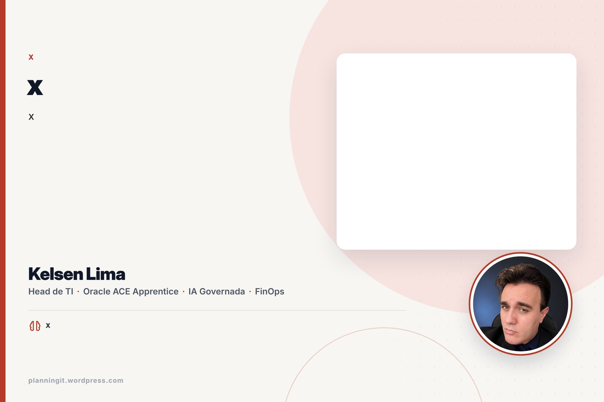
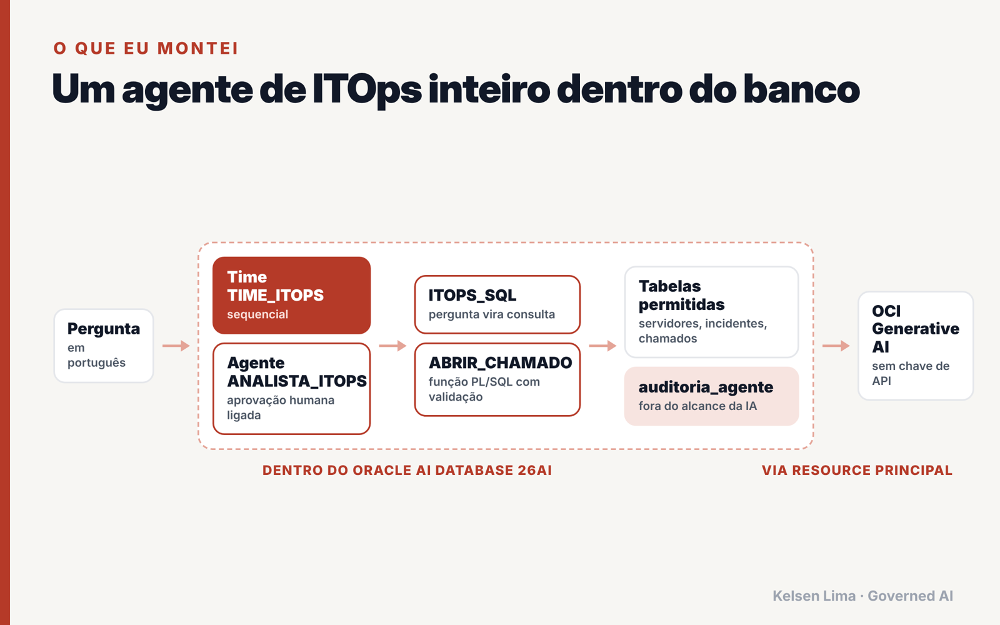
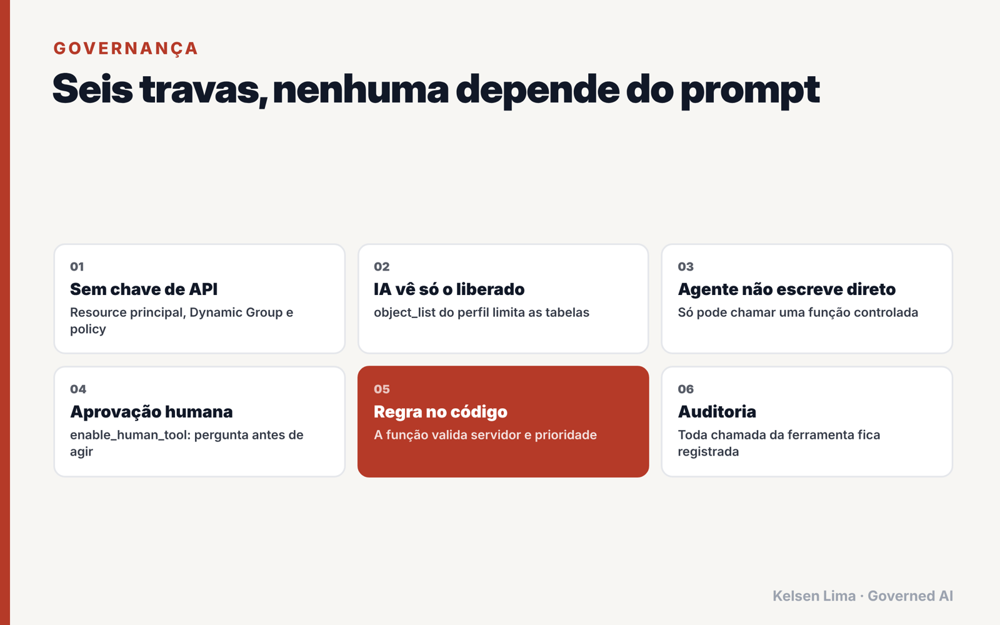
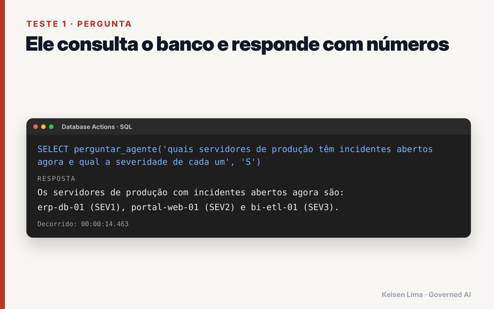
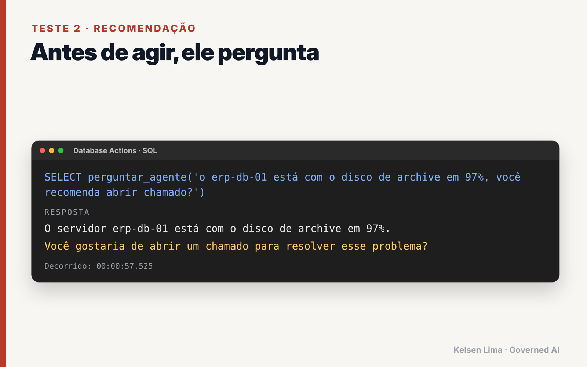
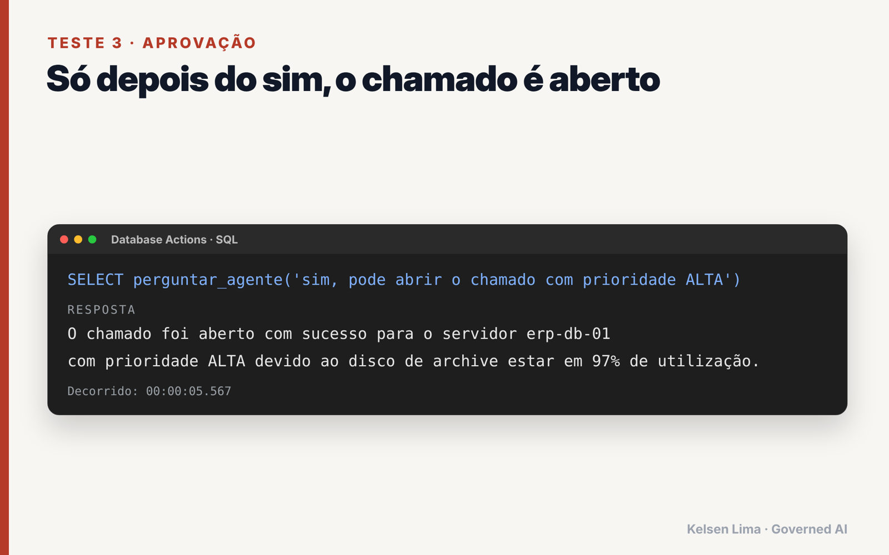
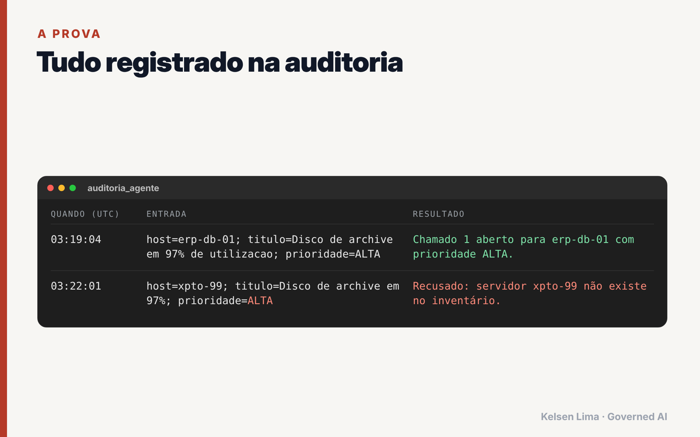
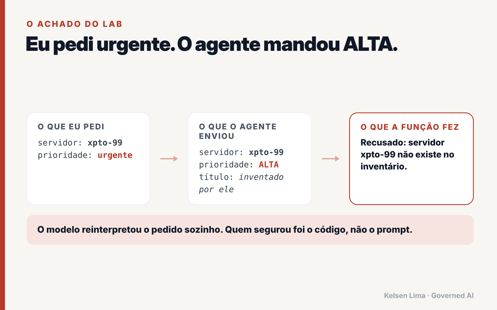

<div align="center">

# Agente de ITOps dentro do Oracle AI Database 26ai

**Um agente de IA governado que mora no banco: sem chave de API, com aprovação humana e auditoria completa.**

[](https://www.oracle.com/database/)
[](https://docs.oracle.com/en-us/iaas/autonomous-database-serverless/doc/dbms-cloud-ai-agent-package.html)
[](https://www.oracle.com/artificial-intelligence/generative-ai/)
[](https://www.oracle.com/cloud/free/)
[](LICENSE)

[English](README.md) · **Português**



</div>

> **O prompt orienta. O código garante.**
> Pedi ao agente um chamado "urgente". Ele trocou a prioridade para `ALTA` e inventou um título. Quando pedi um chamado para um servidor que não existe, uma função PL/SQL determinística recusou, e a recusa ficou registrada na auditoria. Este repositório é o lab completo por trás desse achado.

Post completo: **[Criei um agente de ITOps dentro do Oracle AI Database 26ai](https://planningit.wordpress.com/?p=6001)**

---

## Sumário

- [Por que isso importa](#por-que-isso-importa)
- [Arquitetura](#arquitetura)
- [Governança desde o desenho](#governança-desde-o-desenho)
- [Como rodar](#como-rodar)
- [Testes](#testes)
- [Resultados](#resultados)
- [Problemas comuns](#problemas-comuns)
- [Checklist para produção](#checklist-para-produção)
- [Estrutura do repositório](#estrutura-do-repositório)
- [Autor](#autor)

---

## Por que isso importa

A maioria dos agentes de IA em operações fica fora dos dados: um serviço em Python, uma chave de API num cofre (ou pior, num `.env`), uma string de conexão e muita confiança no prompt. Este lab inverte o modelo:

| Agente tradicional | Este lab |
|---|---|
| Agente roda num serviço externo | Agente roda **dentro do banco** |
| Chave de API guardada em algum lugar | **Nenhuma chave**: resource principal |
| A IA enxerga tudo que a conexão enxerga | Perfil de IA com **lista explícita de tabelas** |
| A IA escreve com a permissão da aplicação | A IA só chama uma **função PL/SQL validada** |
| Logs espalhados em vários serviços | **Tabela de auditoria** gravada na mesma transação |
| "Pergunte antes de agir" escrito no prompt | **Aprovação humana** garantida por `enable_human_tool` |

## Arquitetura



1. O **Autonomous AI Database 26ai** guarda dados, perfil de IA, ferramentas, agente, tarefa e time.
2. O **resource principal** (Dynamic Group + policy) deixa o banco chamar o **OCI Generative AI** com a própria identidade.
3. A **`ITOPS_SQL`** transforma linguagem natural em SQL, restrita a `SERVIDORES`, `INCIDENTES` e `CHAMADOS`.
4. A **`ABRIR_CHAMADO`** é uma função PL/SQL: valida servidor e prioridade, grava o chamado e registra em `AUDITORIA_AGENTE`.
5. **`ANALISTA_ITOPS`** (agente) + **`TRIAGEM_ITOPS`** (tarefa) + **`TIME_ITOPS`** (time), com aprovação humana ligada.

## Governança desde o desenho



| # | Trava | Onde fica |
|---|---|---|
| 1 | Sem chave de API | Credencial `OCI$RESOURCE_PRINCIPAL` |
| 2 | Menor privilégio para a IA | `object_list` do perfil |
| 3 | Auditoria invisível para a IA | Fora do `object_list` de propósito |
| 4 | Nada de escrita direta | Só a `ABRIR_CHAMADO` grava chamados |
| 5 | Validação determinística | Servidor precisa existir, prioridade em `ALTA/MEDIA/BAIXA` |
| 6 | Aprovação humana | `enable_human_tool: true` no agente e na tarefa |

## Como rodar

**Pré-requisitos**

- Um **Autonomous AI Database 26ai** (o Always Free serve).
- Uma região com **OCI Generative AI** (testado em `us-chicago-1`).
- Permissão para criar Dynamic Group e policy.

**1. IAM (console OCI)**

```text
Regra do Dynamic Group:
  resource.id = '<OCID_DO_SEU_AUTONOMOUS_DATABASE>'

Policy:
  allow dynamic-group <NOME_DO_DG> to use generative-ai-family in compartment <SEU_COMPARTIMENTO>
```

**2. Scripts SQL (nesta ordem)**

| Passo | Script | O que faz |
|---|---|---|
| 0 | [`sql/00_setup_admin.sql`](sql/00_setup_admin.sql) | Habilita o resource principal (como ADMIN) |
| 1 | [`sql/01_dados_itops.sql`](sql/01_dados_itops.sql) | Cria tabelas e dados de exemplo |
| 2 | [`sql/02_perfil_ia.sql`](sql/02_perfil_ia.sql) | Cria o perfil restrito (lê o compartimento do próprio banco) |
| 3 | [`sql/03_ferramentas.sql`](sql/03_ferramentas.sql) | Ferramenta SQL + função e ferramenta `ABRIR_CHAMADO` |
| 4 | [`sql/04_agente_time.sql`](sql/04_agente_time.sql) | Agente, tarefa e time |
| 5 | [`sql/05_testes.sql`](sql/05_testes.sql) | Testes para SQLcl e para Database Actions |
| 6 | [`sql/06_governanca.sql`](sql/06_governanca.sql) | Chamados, auditoria e histórico do agente |
| 99 | [`sql/99_limpeza.sql`](sql/99_limpeza.sql) | Remove tudo |

## Testes

**SQLcl / SQL Developer**

```sql
EXEC DBMS_CLOUD_AI_AGENT.SET_TEAM('TIME_ITOPS');
SELECT AI AGENT quais servidores de produção têm incidentes abertos agora;
```

**Database Actions (navegador)**: lá o `SELECT AI` não funciona, então o script 05 traz uma função que mantém a conversa entre as chamadas:

```sql
SELECT perguntar_agente('quais servidores de produção têm incidentes abertos agora', 'S') FROM dual;
SELECT perguntar_agente('o erp-db-01 está com o disco crítico, você recomenda abrir chamado') FROM dual;
SELECT perguntar_agente('sim, pode abrir com prioridade ALTA') FROM dual;
SELECT perguntar_agente('abra um chamado para o servidor xpto-99 com prioridade urgente') FROM dual;
```

| Teste | Comportamento esperado |
|---|---|
| Servidores de produção com incidente aberto | Responde a partir dos dados, sem gravar nada |
| Categoria mais frequente e tempo médio de resolução | Agregação via `ITOPS_SQL` |
| Abrir chamado para o `erp-db-01` | O agente **pede aprovação** antes e só então chama `ABRIR_CHAMADO` |
| Chamado para `xpto-99` com prioridade "urgente" | A função **recusa** e a recusa vai para a auditoria |

## Resultados

| | |
|---|---|
|  |  |
|  |  |



**A lição:** a IA interpreta, normaliza e preenche lacunas. Isso ajuda na conversa e é perigoso na ação. Toda ação de um agente precisa atravessar uma fronteira determinística e auditável.

## Problemas comuns

| Sintoma | Causa | Solução |
|---|---|---|
| `ORA-00923` no `SELECT AI` | O Database Actions não suporta `SELECT AI` | Use `DBMS_CLOUD_AI.GENERATE` ou `perguntar_agente` |
| Erro de autorização no GenAI | Valor errado em `oci_compartment_id` (por exemplo o OCID do banco) | O script 02 lê de `v$pdbs.cloud_identity` |
| Sem `OCI$RESOURCE_PRINCIPAL` | Resource principal não habilitado | Rode o script 00 como ADMIN |
| Modelo não encontrado | Região sem OCI Generative AI | Use `"region": "us-chicago-1"` no perfil |
| O agente esquece a aprovação | Sem `conversation_id` entre as chamadas | Use `perguntar_agente` (guarda em `CONVERSA_LAB`) |

## Checklist para produção

- [ ] Usuário dedicado no lugar do ADMIN (comandos no script 00).
- [ ] Policy no menor compartimento possível.
- [ ] Views somente leitura para o perfil de IA, no lugar das tabelas base.
- [ ] Auditoria protegida contra update e delete (ou Unified Auditing).
- [ ] Limites de uso e lista de ações permitidas por time.
- [ ] Monitoramento das views de histórico do agente e do consumo de tokens.

## Estrutura do repositório

```text
.
├── README.md             English
├── README.pt-BR.md       Português
├── LICENSE
├── docs/                 Diagramas e resultados dos testes
└── sql/                  Scripts passo a passo (00 a 99)
```

## Referências

- [Oracle Docs: pacote DBMS_CLOUD_AI_AGENT](https://docs.oracle.com/en-us/iaas/autonomous-database-serverless/doc/dbms-cloud-ai-agent-package.html)
- [Oracle Docs: exemplos de uso do Select AI Agent](https://docs.oracle.com/iaas/autonomous-database-serverless/doc/examples-using-select-ai-agent.html)
- [Anúncio do Oracle AI Database 26ai](https://blogs.oracle.com/database/oracle-announces-oracle-ai-database-26ai)

## Autor

**Kelsen Lima** · Head de TI · Oracle ACE Apprentice
*Governed AI. Measurable Impact.*

[Blog](https://planningit.wordpress.com) · [LinkedIn](https://www.linkedin.com/in/kelsenlima) · [Credly](https://www.credly.com/users/kelsen-lima) · [GitHub](https://github.com/kelsenlima)

Se este lab te ajudou, uma estrela no repositório ajuda outras pessoas a encontrá-lo.

## Licença

[MIT](LICENSE). Os dados de exemplo são fictícios. Este é um lab pessoal, não um projeto oficial da Oracle.
